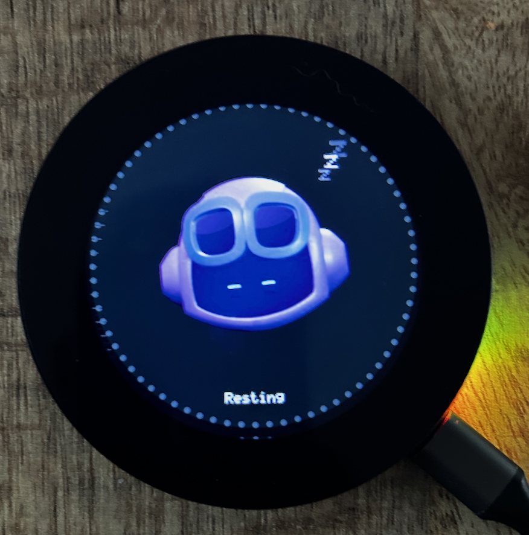
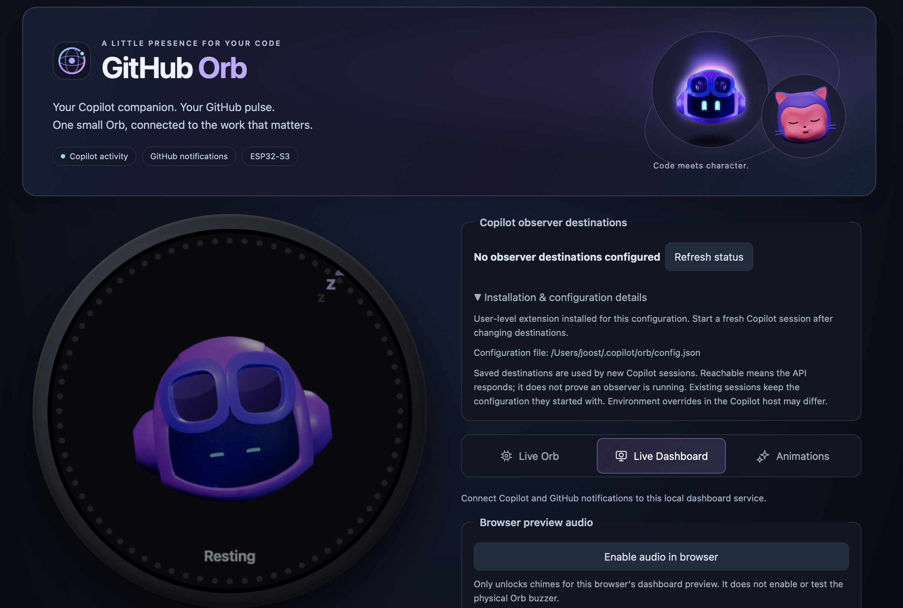

# GitHub Orb

**Your Copilot companion. Your GitHub pulse.**

GitHub Orb brings the work happening in your editor to a small, characterful display on your desk. A Waveshare ESP32-S3 shows live Copilot session activity and selected GitHub notifications, while a local web dashboard helps you set up and manage the experience.

  
  

The physical Orb &nbsp; · &nbsp; The local dashboard

[▶ Watch the GitHub Orb demo on YouTube](https://www.youtube.com/watch?v=QgYR_15GOpI)

- **See Copilot at a glance:** follow supported Copilot sessions as they think, use tools, wait for input, and finish.
- **Keep up with GitHub:** let Mona highlight selected unread notifications on the Orb.
- **Choose your setup:** use the standalone ESP32 display, the local dashboard, or both.
- **Keep conversations private:** the observer sends bounded activity state, not prompts, chat content, tool arguments, or results.

## Guides

| Subject | Guide |
| --- | --- |
| First setup, Wi-Fi, and device provisioning | [Getting started](docs/getting-started.md) |
| Dashboard modes, configuration, and device management | [Orb Dashboard](docs/dashboard.md) |
| Copilot CLI and VS Code observer installation | [Copilot SDK observer](observer/README.md) |
| GitHub notification behavior and Mona | [GitHub notifications](docs/github-notifications.md) |
| Firmware, animation assets, flashing, and recovery | [Firmware guide](firmware/README.md) |
| System boundaries and HTTP/observer protocols | [Architecture](docs/architecture.md) |
| Windows USB forwarding for Docker | [Windows Docker USB](docs/windows-docker-usb.md) |
| Tests and animation-tool validation | [Development and validation](docs/development.md) |
| Credential handling and privacy | [Security and privacy](docs/security-and-privacy.md) |

## Artwork license

The adapted Copilot and Mona models by Martin Woodward and contributors (octoprints), and their derived animation assets, are licensed under **CC BY-NC 4.0**. Commercial use requires separate permission. The copyright license does not grant GitHub trademark rights or imply GitHub affiliation.

## Project license

Unless a file or its accompanying notice says otherwise, the original GitHub Orb source code, documentation, and project materials are licensed under the [PolyForm Noncommercial License 1.0.0](LICENSE). You may copy, modify, and distribute them for noncommercial purposes, provided you include the license terms or their URL and preserve the required copyright notice. Commercial use requires separate permission from Joost Voskuil.

Third-party components and assets retain their own licenses. In particular, the Copilot and Mona models and their derived animation assets above remain under CC BY-NC 4.0; this project license does not replace or expand their terms.
