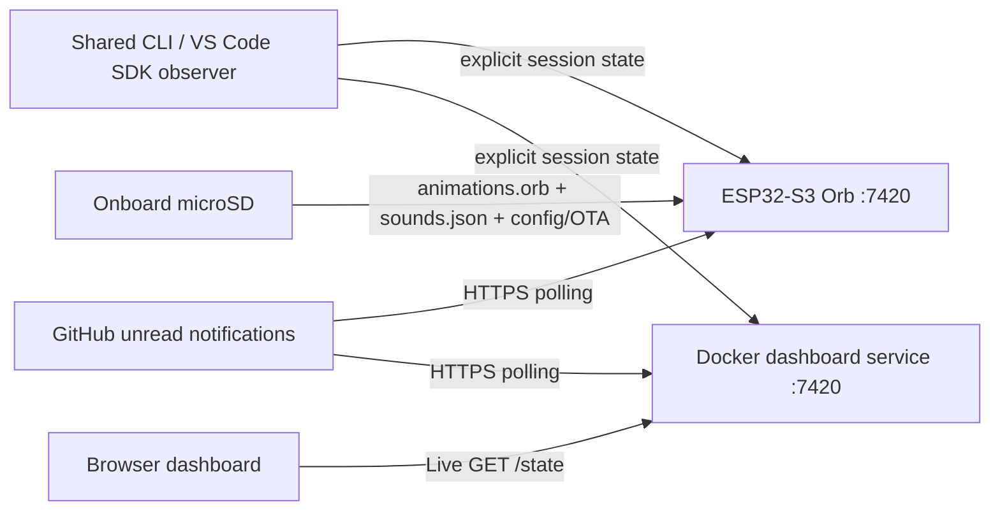

# GitHub Orb

## YouTube Orb Demo

[](https://www.youtube.com/watch?v=QgYR_15GOpI)

## Screenshots


A standalone GitHub activity display for the Waveshare **ESP32-S3-Touch-LCD-2.1B**, showing Copilot activity and GitHub news. The ESP32 connects directly to Wi-Fi, runs an onboard HTTP REST server (`github-orb.local:7420`) for Copilot SDK observers, polls GitHub notifications over HTTPS on a background FreeRTOS task, supports dual-slot OTA updates (`POST /ota` and `/firmware.bin` on the SD card), and streams all 624 animation frames from the microSD card.



## Requirements

- Waveshare **ESP32-S3-Touch-LCD-2.1B**, a FAT32 microSD card, a USB data cable, and PlatformIO.
- Node.js 24 LTS on the host for the Copilot observer and animation tooling. The dashboard runs in a Node 24 Docker container.

The board driver is revision-specific. Verify the revision printed on the board before flashing.

## Provision Wi-Fi, Token & Optional GitHub PAT

The recommended setup uses the host-native **Orb Dashboard**. Run `npm run dashboard` and open <http://127.0.0.1:7420/dashboard/>. The **Live Orb** tab guides you through setup:

1. **Select your Orb:** connect a USB data cable, then select the Espressif USB device.
2. **Connect to Wi-Fi:** open **Set up or change Wi-Fi**, enter a 2.4 GHz network and passphrase, and choose **Connect Orb to Wi-Fi**. This step only changes Wi-Fi. The Orb restarts, attempts the connection, and rolls back to its previous credentials on failure. On success, the dashboard retrieves its IP and API token over USB, atomically saves the gitignored `observer/config.json`, and loads settings from the physical Orb. An already configured Orb loads automatically over Wi-Fi without a USB cable.
3. **Connect Copilot:** use **Install Extension for Live Orb** to add the selected device to the shared observer configuration. Start a fresh Copilot session to use changed destinations.
4. **Customize your Orb:** once settings load, adjust sound, brightness, quiet hours and optional GitHub PAT, then choose **Save to Orb**. Sound is off by default: select **Enable sound on the physical Orb**, set volume above zero, and save. **Test Orb sound** plays a short onboard-buzzer notification using the saved settings; it reports mute, active quiet hours, or missing SD sound assets without changing any sessions. The active buzzer has fixed loudness at nonzero volume. **Enable audio in browser** is in **Live Dashboard** and only unlocks browser-preview chimes, not the physical Orb. These settings use the authenticated Wi-Fi API and never reconfigure Wi-Fi. A failed settings load keeps editing disabled until the connection succeeds.

The **Copilot observer destinations** summary is visible on every tab. It lists whether the saved configuration targets **Live Orb (ESP32)**, **Live Dashboard**, or **both**, along with each host/port, authenticated API reachability, live session count, configuration path and matching user-level extension installation. Tokens never appear on screen. Reachability is not proof that a Copilot observer is running; existing sessions keep their startup configuration, and Copilot-host environment overrides may differ. Use **Refresh status** to recheck; the visible page also refreshes every ten seconds.

The dashboard shares an Orb-branded banner and footer across all three tabs. Branding assets are served locally, without external fonts or image requests.

Wi-Fi passphrases and GitHub PATs are cleared from their forms after submission and are not stored in browser storage. Live Orb uses two columns on desktop: setup and settings on the left, Log followed by always-expanded Device management on the right. These columns stack on smaller screens. The **Live Orb** tab never shows the local Dashboard Orb preview.

USB setup works from the host-native Node.js dashboard on Windows, macOS, and Linux. Docker disables USB access by default. On Windows, forward the Orb into WSL 2 with `usbipd-win` and use the opt-in [Docker USB setup](docs/windows-docker-usb.md). The FAT32 microSD configuration and captive portal remain available as fallbacks:

Under **Device management**, choose **Update through Wi-Fi** (the default) or **Update through USB**. This shared selector applies to both update buttons; it never switches connections automatically. Wi-Fi uses the saved Orb connection, while USB uses the Orb selected in settings and does not require Wi-Fi. Copilot extension installation remains USB-only.

To transfer animation and sound assets without removing the microSD card, first publish them with `npm run export:firmware --prefix tools`, then click **Upload animations and sounds** under **SD card assets**. The dashboard sends both published files from `dist/sdcard` through the selected connection. Choose **Restart to load assets** afterwards; restart uses the original upload target even if you change the selector. Each file is validated before replacing its previous copy. The two files are not a transactional bundle: if the second fails, the dashboard reports the first file as already updated. Attribution must still be copied to the card manually.

To build and publish firmware, run `npm run firmware:build`. This builds the PlatformIO application and copies a timestamped `.bin` into `dist/firmware`. Click **Upload latest firmware** to send the newest binary through the selected connection. Successful firmware updates restart automatically and must fit the 3 MiB inactive OTA slot. USB updates use the running Orb's serial protocol, without PlatformIO on the dashboard host. Older firmware needs one initial developer USB flash to enable USB firmware updates and Wi-Fi asset uploads. Initial installation and recovery flashing remain available through PlatformIO.

1. Copy `firmware/data/animations.orb`, `firmware/data/ATTRIBUTION.txt`, and `firmware/data/sounds.json` to the root of the FAT32 microSD card.
2. Optionally create `/config.json` on the SD card root to pre-populate Wi-Fi, your API bearer token, and an optional GitHub PAT (imported into NVS on boot):
   ```json
   {
     "wifiSsid": "YourWiFi",
     "wifiPassword": "YourPassword",
     "hostname": "github-orb",
     "port": 7420,
     "token": "replace-with-your-secret-token",
     "githubPat": "",
     "githubPollSec": 60,
     "timezone": "CET-1CEST,M3.5.0,M10.5.0/3"
   }
   ```
3. If Wi-Fi is not configured or unreachable, the ESP32 starts the **`GitHub-Orb-Setup`** access point (`http://192.168.4.1/`) where you can select your 2.4 GHz Wi-Fi network and enter the token, optional GitHub PAT, poll interval, and POSIX timezone.
4. Once connected, the ESP32 advertises `http://github-orb.local:7420` via mDNS and responds to `curl -fsS http://github-orb.local:7420/health`.

## Connect the Copilot observer

Create `observer/config.json` (gitignored) with your observer-capable ESP32 host, port, and token:

```json
{
  "host": "github-orb.local",
  "port": 7420,
  "token": "replace-with-your-secret-token"
}
```

Then install the SDK extension:

```sh
npm run observer:install
```

This installs the observer for extension-enabled Copilot sessions. Use `npm run observer:install -- --project` for checkout-only installation. See [`observer/README.md`](observer/README.md) for runtime requirements, environment overrides (`ORB_HOST`, `ORB_PORT`, `ORB_TOKEN`, `ORB_CONFIG`), and verification.

## Copilot SDK observer (experimental)

The shared observer follows the main agent, tools, subagents, and attention requests in one Copilot session. It sends **one aggregate state per session**, using actual session IDs rather than working-directory IDs. Long-running tools remain working; only explicit approval/question events select `needsInput`. Only session-level failures select `error`, and cancellation is not successful completion.

The same observer can run in extension-enabled Copilot CLI and VS Code **Copilot-harness** sessions. The existing protocol source `cli` represents both SDK hosts; it is not a claim that the session was opened in a terminal. VS Code Local, Claude, Codex and cloud sessions are not covered.

See [observer setup and validation](observer/README.md). Use the updated dashboard first if the board still runs older firmware. Installation is opt-in; it does not change VS Code settings or update the board.

## GitHub news with Mona (optional)

The ESP32 polls GitHub notifications directly on a background FreeRTOS task when `githubPat` is configured (via `/config.json` on the SD card, the `GitHub-Orb-Setup` captive portal, or `PUT /settings`). An empty PAT disables polling. Polling accepts integer seconds from **30–3600**, defaults to 60, and honors GitHub `X-Poll-Interval` and rate-limit headers.

### PAT permissions and coverage

Use a **classic PAT** with the `notifications` scope. The integration calls only GitHub's notifications endpoint; it does not query user, pull-request, Actions, or Dependabot endpoints. The account must be able to see the repositories represented in its inbox, and organization SSO authorization may be required. Fine-grained PATs are unsupported by the notifications endpoint. See GitHub's [notifications API documentation](https://docs.github.com/en/rest/activity/notifications) and confirm current permission requirements before granting scopes.

The integration performs authenticated **GET requests only**, exclusively to `GET /notifications?all=false&participating=false&per_page=30&page=1`. It never marks notifications read, modifies threads, or changes repositories. Only **unread notification threads** are processed, and repositories are discovered **only from those threads**. The inbox reason selects the display:

- `security_alert` shows Mona's scared/security animation.
- `ci_activity` shows Mona's workflow-failed animation and label. GitHub's reason denotes CI activity completion, not necessarily failure; this display mapping does not fetch or independently verify the run result.
- `approval_requested` (and GitHub's `review_requested` / `assign`) shows Mona asking for PR attention. GitHub defines `approval_requested` for deployment approvals; by this display mapping it uses the PR-attention pose, linking to the repository when the subject is not a PR.
- `agent_session_finished` shows Copilot's Done animation for 10 seconds, then returns to the latest event-driven Copilot state. New Copilot activity cancels that brief completion display.
- Every other reason shows Mona asking for attention.

This is not comprehensive workflow/security monitoring: delivery depends on your GitHub notification settings and unread inbox. It does not scan arbitrary repositories, code-scanning alerts, or workflow run results.

At startup, unread inbox threads whose `updated_at` is at or before the Orb boot time (or dashboard start time) are ignored; only threads updated afterward can be displayed. Firmware waits for a valid system clock before polling, and records ignored thread timestamps for deduplication. If an ignored thread is updated after startup, that newer revision is eligible. Each poll deduplicates inbox notifications and displays the highest-priority, newest **fresh** item: **security > workflow failure > PR attention > Copilot done > other notification**. Lower-priority items are not queued. Mona is sticky “latest news,” not a queue: she holds her final pose until another fresh Mona notification takes over or you acknowledge her locally. Copilot events continue updating underlying sessions but never dismiss a Mona notification. Tap Mona once to see the type, organization (or owner for a personal repository), repository, and title; tap the details card again to dismiss and return to Copilot's latest state (tap outside the card to close details without dismissing). In the dashboard, tap the Orb preview the same way; the **Live Dashboard** tab acknowledges via the authenticated API. This does **not** mark the GitHub notification read. The active presentation and its acknowledgement are memory-only, so a restart clears them; deduplication remains persisted.

Deduplication is persisted in `/github-state.json` on the microSD card, written atomically via `/github-state.tmp`. Mascot/latest-news presentation itself is memory-only. Inspect **authenticated `GET /github/status`** using the **ESP32 bearer token, not the PAT** for enabled/status/last-success and sanitized errors. Since polling uses only the inbox endpoint, there are no detail-permission checks; inbox access, connectivity, or storage failures can produce `error`. The dashboard shows safe diagnostic details in GitHub status and adds problems/recovery notices to the **Messages** panel. Public `/health` does not expose GitHub status or secrets.

Mona clips are `mona-pr`, `mona-workflow`, and `mona-security`. In the dashboard, use **3D frame sequences** and the mascot/clip previews. Missing Copilot frames fall back to available image artwork, then a drawn face; Mona uses a procedural cat-eared fallback rather than Copilot artwork (also when image/vector mode is selected). News links accept only safe HTTPS `github.com` URLs.

## Build the display and OTA updates

See [`firmware/README.md`](firmware/README.md) for asset generation, USB flashing, OTA updates (`POST /ota` and SD `/firmware.bin`), provisioning, diagnostics, and recovery.

The 16 MB flash layout provides dual 3 MiB OTA application slots (`app0` and `app1`) plus `nvs`, `otadata`, and `phy_init`, leaving 9.875 MiB unallocated. `animations.orb` and `ATTRIBUTION.txt` are stored on the microSD card root.

## Orb Dashboard and observer configuration

| Variable | Purpose | Default |
|---|---|---|
| `ORB_CONFIG` | Observer JSON config path | `observer/config.json` |
| `ORB_HOST` | Observer destination (ESP32 or dashboard) | `github-orb.local` |
| `ORB_PORT` | Destination HTTP port, `1–65535` | `7420` |
| `ORB_TOKEN` | Destination API bearer token | from `observer/config.json` |

The Orb Dashboard has three tabs:

- **Live Orb** configures the physical device: Wi-Fi name/passphrase, GitHub PAT and poll interval, sound, volume, brightness, quiet hours, and POSIX timezone. Settings load from the saved physical Orb connection on startup; **Load from Orb** reloads them, and **Save to Orb** persists them in the ESP32's NVS. Leave both Wi-Fi fields blank to preserve the connection, and leave the PAT blank to preserve its saved value. Use **Remove saved PAT** explicitly to disable device GitHub polling. Only Wi-Fi changes require USB; other settings save over the LAN, including when Docker USB access is disabled. Passwords and PATs are cleared from the form after a save attempt, are never returned by the settings API, and are not stored in browser storage or dashboard logs. Device maintenance contains asset uploads and firmware updates. **Install Extension for Live Orb** adds the selected physical Orb as an observer destination.
- **Live Dashboard** shows local service status and lets you add the dashboard service as another destination for the same user-level Copilot observer. For Docker Compose, the endpoint uses the published host port (default `7421`); for a host-native dashboard it uses the local dashboard port (default `7420`). Start a fresh Copilot session after adding a destination. The observer sends to all configured endpoints concurrently, so both the Orb and local dashboard can receive the same session updates. GitHub notifications can use a PAT saved through this tab; the service stores it in its private data directory with file permissions `0600`, and the token is never returned to the browser. If a non-empty `ORB_GITHUB_PAT` is configured on the server, it takes precedence and the UI displays that it is environment-managed.
- **Animations** runs local scenarios without changing live service state.

Sound, brightness, and quiet-hours edits also update the dashboard's in-memory preview; they reach the physical Orb only when you save. Recent observer events and dashboard actions appear in the Log below the Orb. The canvas previews the local dashboard service; it is not a live screen feed from the physical Orb.

Start the dashboard on localhost with Docker Compose:

```sh
cp -n .env.example .env
# Add or update ORB_TOKEN in .env with a unique secret; optionally set ORB_GITHUB_PAT.
docker compose up --build -d
```

Open <http://127.0.0.1:7421/dashboard/>. Compose binds to localhost port `7421` and forwards to the dashboard's internal port `7420`; the internal port stays compatible with the ESP32 API. By default Docker supports all three tabs, while USB setup is disabled. Windows users can enable USB forwarding using [the WSL 2 USB setup](docs/windows-docker-usb.md). GitHub deduplication data and a UI-saved GitHub PAT are persisted in a named volume. Stop the container with `docker compose down`; the volume is retained.

The **Messages** panel below the Orb shows field/value summaries of recent `/event` payloads, including allowlisted titles and session labels. Unknown fields such as credentials are omitted. The in-memory history is bounded to 40 messages.

A single Copilot avatar is shown, always at the front, following the selected session; up to three sessions are indicated by ring arcs. Thinking, executing tools, and waiting for input count as working. When a session finishes while another is working, it stays as a ring arc for up to two minutes from completion, then disappears. Finished avatars never automatically or manually displace working sessions; tapping them opens their details. Idle sessions that never completed and failed sessions disappear immediately. With no working sessions, all session avatars disappear; resting shows one default sleeping Copilot, without session arcs or touch targets. Meaningful activity queues a gentle 700 ms rotation, with at least four seconds per session; token updates do not rotate the carousel. Input requests hold the front until resolved. Tap a working ring arc to focus it for six seconds, then tap the front avatar or selected arc for details. Open cards pause activity-driven rotation, but completion still yields the front to working sessions. Mona and GitHub completion notifications still take over while session activity continues underneath.

To send Copilot observer states to the dashboard as well as a physical Orb, choose **Install Extension for Live Dashboard** in its tab; this adds the local service to the user-level observer's private endpoint list. Use **Install Extension for Live Orb** to add or update the physical device endpoint. To run the dashboard outside Docker with host USB access, use Node 24 LTS and `npm run dashboard`.

## Validation

```sh
npm test
```

Current animation artifact: **15 clips, 1,140 frames, 320×320 at 12 fps, 12,245,081 bytes**. For Mona preparation, rendering and browser-pixel verification, see [`tools/MONA.md`](tools/MONA.md): `npm run prepare:mona --prefix tools`, `npm run render:mona --prefix tools`, `npm run export:firmware --prefix tools`, then `npm test --prefix tools` and `npm run verify:mona --prefix tools`. These tools do not upload to a device; browser pixel checks are not a visual review or hardware validation.

## Security and privacy

- The ESP32 API and dashboard use unencrypted HTTP; keep them on trusted networks.
- The dashboard is bound to `127.0.0.1` by default. Do not expose its port to the LAN or internet without adding suitable transport security and access controls.
- Authenticated API routes require the configured Orb token; `/health` and static dashboard/media files are public.
- The observer forwards aggregate mood, source, session and instance identifiers, ordering metadata, bounded working-folder name and tool name. Prompts, chat content, reasoning, questions, answers, tool arguments and results are never sent.
- Physical-device state and settings remain on the ESP32. Dashboard state is held in the container process; its GitHub deduplication data and UI-saved GitHub PAT are stored in the Compose volume.
- The dashboard's GitHub PAT may be provided via `.env`/Compose or saved from the local UI; UI-managed credentials use a private file and are never sent back to the browser or returned by diagnostics. Authenticated state includes alert titles, repository names, and links, so protect `ORB_TOKEN` and the ESP32 token. Never expose credentials through public diagnostics.

## Documentation

- [`docs/architecture.md`](docs/architecture.md) — state protocol, flash format, and responsibility boundaries.
- [`observer/README.md`](observer/README.md) — shared VS Code Copilot-harness and CLI observer setup.
- [`firmware/README.md`](firmware/README.md) — hardware build, flash, and recovery.

## Artwork license

The adapted Copilot and Mona models by Martin Woodward and contributors (octoprints), and their derived animation assets, are licensed under **CC BY-NC 4.0**. Both use revision `981a85f0bec9d1a9c280fd5719d0d797852229c4`; acquiring Mona at that revision does not refresh Copilot. Source, hashes and adaptations are recorded in `media/copilot/source.json` and `media/mona/source.json`; retain both `LICENSE.txt` files and `firmware/data/ATTRIBUTION.txt`. Commercial use requires separate permission. The copyright license does not grant GitHub trademark rights or imply GitHub affiliation.

## Project license

Unless a file or its accompanying notice says otherwise, the original GitHub Orb source code, documentation, and project materials are licensed under the [PolyForm Noncommercial License 1.0.0](LICENSE). You may copy, modify, and distribute them for noncommercial purposes, provided you include the license terms or their URL and preserve the required copyright notice. Commercial use requires separate permission from Joost Voskuil.

Third-party components and assets retain their own licenses. In particular, the Copilot and Mona models and their derived animation assets above remain under CC BY-NC 4.0; this project license does not replace or expand their terms.