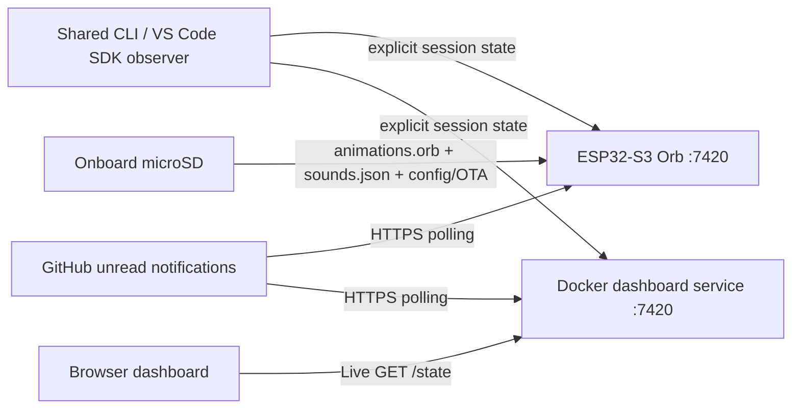
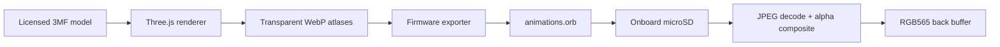

# Architecture and protocol



## Responsibility boundary

The ESP32-S3 GitHub Orb runs standalone and owns physical-device session aggregation, mood priority, event-to-mascot/mood selection, optional GitHub notification polling, sticky mascot/news selection, the HTTP REST + OTA server (`:7420`), mDNS (`github-orb.local`), playback timing, one-shot behavior, disconnected fallback, overlays, brightness, sounds, and SD media storage. The Docker dashboard service implements the compatible state/event API and GitHub polling for the browser UI and SDK observer. Its Live display is independent of the physical Orb; local-only management endpoints can provision, configure, and update the device using its saved connection. `protocol/emotions.json` defines mood animations, labels, rings, and browser chimes; the physical buzzer loads its short pulse patterns from `/sounds.json` on the SD card.

## ESP32 HTTP REST protocol

The Copilot SDK observer targets either `http://github-orb.local:7420` for a physical Orb or the locally published dashboard at `http://127.0.0.1:7421`. The dashboard's Live mode talks to its own service:

- `GET /health` (public): returns `{ status, uptimeSec, wifiConnected, ip, hostname, rssi }`.
- `POST /event` (auth): accepts explicit SDK observer updates (defined below) and the compatible legacy shape `{ source, event, sessionId, tool, chat?, title?, project? }` for dashboard previews and older clients. Legacy names rank id < project < title < chat; names are bounded to 40 characters. The SDK observer sends only a bounded project label, not prompt or chat text.
- `GET /state` (auth): returns the resolved presentation snapshot:

```json
{
  "type": "state",
  "mood": "tool",
  "clip": "tool",
  "task": "execution_subagent",
  "ring": { "mode": "animated", "anim": "chase", "color": "#2f81f7", "speed": 0.18, "width": 8 },
  "tool": "execution_subagent",
  "source": "vscode",
  "mascot": "copilot",
  "presentationId": 1,
  "sessions": [{
    "source": "cli", "sessionId": "sdk-session-id", "name": "Fix the build", "state": "tool", "tool": "bash",
    "slot": 0, "ended": false, "closed": false, "finished": false,
    "agent": "Planner", "subagent": "explore", "model": "GPT-5.4",
    "inputTokens": 18240, "outputTokens": 1460, "contextPercent": 37, "busySec": 42
  }],
  "primary": 0,
  "hiddenSessions": 0,
  "sessionCount": 1,
  "settings": {
    "sound": false,
    "volume": 0.5,
    "brightness": 1,
    "quietHours": { "enabled": true, "start": "22:00", "end": "08:00" }
  },
  "ts": 123456
}
```

- `GET /settings` & `PUT /settings` (auth): reads or updates sound, volume, brightness, quiet hours, timezone, and optional `githubPat` / `githubPollSec` in NVS.
- `POST /audio/test` (auth): schedules a physical buzzer notification without changing sessions. Respects saved sound/mute and quiet hours; missing SD sounds and busy playback return explicit errors. The local-only dashboard proxy is `POST /setup/audio/test`. Browser preview audio is unlocked separately in Live Dashboard.
- `GET /github/status` (auth): returns sanitized GitHub poller status (`disabled`, `starting`, `ok`, `error`).
- `POST /github/acknowledge` (auth): accepts `{ "id": "<current alert id>" }`; returns `409 alert_changed` for a missing or replaced alert. Acknowledges locally without modifying GitHub.
- `POST /github/simulate` (auth): shows a demo Mona alert without GitHub. Accepts `{ "kind", "title", "repository", "url"?, "organization"? }` using a Mona alert kind such as `criticalSecurity`; returns `202 {"id":"demo-…"}`, acknowledged like a polled alert. `GET /health` reports `alertSimulation: true` when supported.
- `POST /ota` (auth): streams a firmware binary to the inactive OTA partition and restarts.
- `POST /assets` (auth): streams one allowlisted SD asset with exact length and an `X-Orb-Asset` header; validates before replacement.
- `POST /restart` (auth): explicitly restarts to load uploaded assets; rejects active update conflicts.

Copilot moods are `idle`, `thinking`, `tool`, `needsInput`, `done`, and `error`; `disconnected` is used when Wi-Fi is offline. Mona moods are `prAssigned`, `reviewRequested`, `workflowFailure`, and `securityAlert`. Every resolved snapshot carries `mascot`, `mood`, `clip`, `task`, and `ring`. Ring `mode` is explicitly `animated` or `solid`; `anim` selects the animation style when animated.

Authenticated REST endpoints accept `Authorization: Bearer <token>`, `X-Orb-Token: <token>`, or `?token=<token>`. Keep the ESP32 on a trusted LAN.

`GET /state` returns the resolved presentation snapshot. Mona PR-assignment and review-request events have distinct moods and task labels but share `mona-pr`; `ci_activity` selects `mona-workflow`, and `security_alert` selects `mona-security`. Other inbox reasons select Mona's attention pose. `agent_session_finished` briefly selects Copilot's `done` pose instead of Mona. Alert details include the repository owner (identified as an organization when GitHub reports that owner type), repository name, and title. News sets `source: "github"` and `tool: null`, masking the aggregate mood but preserving `sessions` and settings. GitHub is not a session source. Copilot events continue changing sessions under Mona without restarting her clip. First touch opens the notification details card; a second touch on the card acknowledges the currently shown alert and restores the latest Copilot presentation. A fresh news item may replace the displayed alert; stale acknowledgements cannot dismiss it. This presentation is memory-only across restarts.

The adapter contract in [`../tools/MONA.md`](../tools/MONA.md) separates assets from clients: select animation by the resolved **clip**, and use the accompanying task and ring fields rather than reconstructing them from mood. A newer presentation revision restarts even the same clip. Unchanged session updates do not restart playback; identity/clip/mood changes also trigger transitions. Mona one-shots clamp to their final frame. Missing/invalid Mona clip metadata defaults to `mona-pr`. Disconnect remains a local `disconnected` mood without discarding mascot identity. The dashboard's **Preview** mode runs local scenarios only; it never changes Live state or sends events to an ESP32.

## Dashboard service

The dashboard is built and run with Node.js 24 LTS (`Dockerfile` uses `node:24-bookworm-slim`). `docker compose up --build -d` publishes it on `127.0.0.1:7421`, forwarding to the API's container port `7420`; it is not exposed to the LAN by default. Set `ORB_TOKEN` and optional `ORB_GITHUB_PAT` in `.env`. GitHub deduplication data is persisted in the `dashboard-data` volume. The UI's **Live** mode reads the dashboard's event-driven state and GitHub poller; **Preview** mode is browser-local.

The dashboard mirrors `GET /health`, `POST /event`, `GET /state`, `GET/PUT /settings`, `GET /github/status`, and `POST /github/acknowledge`. Protected API calls from the observer require the configured Orb bearer token; same-origin localhost UI requests do not need a browser-stored secret. Maintenance has a shared Wi-Fi/USB selector (default Wi-Fi, no automatic fallback), with separate firmware and asset actions. `POST /setup/updates/target` captures the selected USB port or saved Wi-Fi connection behind an opaque, expiring identifier. `POST /setup/updates/firmware`, `/assets`, and `/restart` use that captured target; `GET /setup/updates/progress` reports transfer/validation progress. Tokens remain server-side. Restart after assets addresses the original target, not a subsequently changed selector. The local-only `/setup/demo` route (`POST` start, `GET` status, `DELETE` stop and clear) plays a scripted ~40-second recording demo on the saved physical Orb (sleeping, Session one working/executing, a question, the happy done animation, then a Mona security alert) through `POST /event` and `POST /github/simulate`; the timeline lives in `dashboard/demo-sequence.ts`. Without saved observer destinations it reads the USB-attached Orb's address and token over serial, in memory only.

Firmware uses the newest `.bin` published by `npm run firmware:build` in `dist/firmware` and must fit the 3 MiB inactive OTA slot. Assets use the two published files in `dist/sdcard`; each replaces its previous SD copy only after validation, but the pair is not transactional. Firmware restarts automatically; assets require explicit restart. Wi-Fi supports both actions with USB disabled. The existing `GET/HEAD /firmware/latest`, Wi-Fi `POST /ota` proxy, and USB `/setup/assets` routes remain for compatibility. Older firmware needs one developer USB flash for the new transport paths; recovery remains outside the dashboard.

The unified **Orb settings** form uses local-only `GET/PUT /setup/settings` to load and persist physical device settings through its authenticated `/settings` endpoint. These requests use `observer/config.json` (or `ORB_CONFIG`, with the existing connection environment overrides), not browser-supplied hosts or tokens, and work without USB access. The proxy checks `/health` and rejects dashboard destinations rather than reporting an in-memory update as a physical save. Responses allowlist non-secret settings and `githubConfigured`; PATs and API tokens are never returned. Omitting `githubPat` preserves it, while an explicit empty string removes it. A Wi-Fi edit first provisions over USB and saves the new connection, then applies the remaining settings over HTTP; a failure at the second stage reports a partial save. Preview-setting updates still use the dashboard's own `/settings` endpoint and never implicitly persist device settings.

The Docker image sets `ORB_USB_SETUP=off` by default; USB requests report `serial_unavailable`, without disabling Wi-Fi maintenance. On Windows, `compose.windows-usb.yaml` opts in and maps the WSL serial device into the container. The runtime image installs the production `serialport` dependency. See [`windows-docker-usb.md`](windows-docker-usb.md) for forwarding and permissions. The host-native dashboard leaves USB enabled for provisioning, application updates, asset uploads and restart. Serial updates use bounded acknowledged chunks, with shared device-side write ownership and cleanup on abort/timeout; HTTP OTA and assets participate in the same ownership. macOS serial reads use `vmin: 0`, `vtime: 1` so short control replies are delivered promptly.

## State aggregation

- Sources: `vscode`, `cli`, and `sim`.
- Priority: `needsInput > error > tool > thinking > done > idle`.
- Done persists for 10 seconds; Error for 30 seconds.
- Legacy sessions close after 15 minutes of inactivity; observer sessions remain active until `observerEnd` or an Orb restart.
- A session counts as *ended* once it stops working (done/idle/error) or closes. Ended sessions stay visible for two minutes and are then hidden; closed ones are removed. Idle/completed/closed sessions show green dots until hidden. A session that just completed plays the one-shot `done` (happy) clip without sleeping letters for the done period; idle or closed sessions rest with the `idle` clip and sleeping letters. Busy legacy sessions without events also hide after two minutes. With no displayed sessions, Copilot sleeps with faded dots. New work revives an ended session.
- At most three sessions are displayed, in sticky slots that map to arcs of the ring (slot 0 at 12 o'clock, clockwise). A session keeps its slot until it is hidden; when all slots are taken, a more urgent session replaces the lowest-priority (oldest-ended) one. Extra visible sessions are counted in `hiddenSessions`. `sessionCount` counts live (not closed) sessions.
- The mascot, task and bottom caption follow the most urgent displayed session (`primary`).
- A pending tool becomes `needsInput` after 8 seconds unless ignored by configuration.
- Sessions are memory-only and reset when the ESP32 reboots.

### Explicit SDK observer protocol (version 1)

The CLI/VS Code Copilot-harness observer uses the same authenticated `POST /event` endpoint with an additive contract. Both SDK hosts use source `cli` (shared Copilot), not a guessed UI identity. Legacy payloads remain supported and retain their existing timeouts.

```json
{
  "source": "cli",
  "event": "observerState",
  "observerVersion": 1,
  "sessionId": "sdk-session-id",
  "instanceId": "11111111-1111-1111-1111-111111111111",
  "startedAt": 1792177483000,
  "sequence": 1,
  "state": "tool",
  "tool": "bash",
  "project": "copilotesp32"
}
```

- Events: `observerState` and `observerEnd`. `observerEnd` requires the ownership fields but no state/name/tool.
- `state` is one of `idle`, `thinking`, `tool`, `needsInput`, `done`, `error`. Tool is optional/null, at most 63 UTF-8 bytes; project is optional, at most 40 UTF-8 bytes. Labels cannot contain control characters.
- Session IDs are 1-95 ASCII letters/digits/underscores/hyphens, fitting the firmware's 96-byte buffer. Instance IDs are 36 lowercase hexadecimal/hyphen characters, generated as UUIDs by the sender.
- `startedAt` is the observer instance's positive safe-integer Unix millisecond start epoch, stable for that instance; `sequence` is a positive uint32, increasing across all of its messages. Sender operations are serialized. A later start epoch can take ownership through a state update; an earlier epoch, same-epoch competing instance, changed epoch within an instance, or non-increasing sequence is rejected. Hosts need consistent clocks for continuation; a clock rollback can cause an explicit ownership conflict instead of a silent takeover.
- Accepted messages return `202 { "accepted": true }`. Invalid observer messages return `400 { "error": "invalid_observer_event" }`; absent ownership for end returns `409 { "error": "observer_missing" }`; superseded/stale/ended ownership returns `409 { "error": "observer_conflict" }`. These explicit errors are additive; legacy event acceptance responses are unchanged.
- A state update establishes one session. Explicit tool state never runs legacy approval inference. The observer aggregates all outstanding work and attention requests before sending; the device does not need raw SDK payloads or child sessions.
- Repeated identical state/name-only updates do not restart playback or mood holds. A meaningful mood/tool change switches from news to Copilot. Session end preserves sticky news.
- Session end preserves sticky news. Ended ownership is retained as a tombstone (displayed as closed for up to two minutes) within the same bounded session storage, excluding it from live counts and preventing that instance from recreating the entry. Active observer sessions do not expire from inactivity; session state and ownership are memory-only, bounded by the 16-entry capacity, and cleared on Orb restart.
- Additional optional `observerState` fields: `subagent` (≤24 bytes, running subagent; `agent` is the selected custom agent), `contextPercent` (integer 0–100), `busyForMs` (uint32, elapsed time of the current request, so clocks need not agree) and `attention` (only with `state: "needsInput"`):

```json
{ "id": "0123456789abcdef", "kind": "shell", "reason": "Run the unit tests", "preview": "npm test", "pending": 1 }
```

  `id` is a 16-hex observer nonce (never the SDK request ID). `kind` is one of `shell`, `write`, `read`, `url`, `mcp`, `memory`, `custom-tool`, `other`, `question`, `plan`, `limits`. `reason` ≤80 bytes and `preview` ≤60 bytes; unknown keys are rejected. `question`, `plan` and `limits` are display-only: they must not carry `reason`/`preview`. `pending` (1–255) counts outstanding requests; the oldest is shown.
- Legacy events cannot overwrite a currently observer-owned session with the same source/ID.

See [observer setup and support limits](../observer/README.md) for experimental host gates, privacy, installation and removal. A shared SDK does not mean all VS Code harnesses load extensions. No model-facing tool or permission/input handler is installed by the observer; The Orb is read-only: it shows what needs attention but never approves or denies.

## GitHub ingestion and sticky latest news

The ESP32 GitHub poller reads its PAT and polling interval from device configuration, persisted in NVS. An empty PAT disables polling. The interval defaults to 60 seconds and accepts integers 30–3600; GitHub rate-limit headers can increase the delay. See the root README for the classic PAT `notifications` scope, fine-grained PAT limitations, and possible organization SSO authorization.

The poller makes one authenticated request per poll: `GET /notifications?all=false&participating=false&per_page=30&page=1`. It makes no user, pull-request, Actions, or Dependabot detail requests, and does not mark notifications read or modify threads. Classification uses only inbox fields:

1. `security_alert`: show Mona's scared/security animation.
2. `ci_activity`: show Mona's workflow-failed animation and label. GitHub's reason denotes CI activity completion, not necessarily failure; this display mapping does not fetch or independently verify the run result.
3. `approval_requested`, `review_requested`, or `assign`: show Mona asking for PR attention. GitHub defines `approval_requested` for deployment approvals; it uses the repository link when the subject is not a PR, otherwise the PR URL is derived from the subject URL.
4. `agent_session_finished`: show Copilot's Done animation for 10 seconds, then return to the latest event-driven Copilot state. New Copilot activity cancels that brief completion display.
5. All other unread notification threads: show Mona asking for attention using the inbox subject and repository.

Notification settings and unread inbox contents constrain coverage; there is no repository-wide workflow/security scan. Inbox requests reject redirects; alert links must be HTTPS `github.com`. Conditional ETags avoid unchanged inbox work. At startup, unread threads whose `updated_at` is at or before the Orb boot time (or dashboard start time) are ignored; only later updates are eligible for display. Firmware waits for a valid system clock and records ignored timestamps for deduplication, so a subsequent update to an old unread thread can appear. All fresh notifications are ingested/deduplicated, but each poll publishes only the highest-priority newest fresh item: **security > workflow failure > PR attention > Copilot done > other notification**. Lower-priority items from that poll are not queued for later display.

Thread timestamps and alert IDs are persisted atomically in `/github-state.json` on the microSD card; the stored history is bounded to 2,000 threads and 4,000 alerts, not an unlimited archive. The firmware keeps the current presentation and Copilot sessions in memory: Mona remains until fresh Mona news or local acknowledgement; Copilot activity continues updating underneath. `agent_session_finished` is a separate 10-second Copilot Done presentation, then the latest event-driven state resumes. `sessionEnd` does not dismiss Mona. Rebooting loses the presentation and sessions but retains GitHub deduplication history on the card.

Authenticated **GET `/github/status`** returns sanitized health only: disabled/starting/ok/error, last success and generic diagnostics, never PATs, API bodies or repository names. Inbox/authentication failures produce errors. Public `/health` stays generic. Authenticated state intentionally contains bounded news metadata; static assets and public endpoints contain no credentials.

## Animation pipeline



`media/animations/manifest.json` is canonical. Atlases use 320×320 frames at 12 fps. Copilot retains five 96-frame loops and two 36-frame one-shots (552 frames). Mona adds `mona-pr`, `mona-workflow`, and `mona-security`: each is a 24-frame, two-second one-shot, settling at 1.5 seconds with six stable closing frames. Total: **10 clips / 624 frames**. Posters are PNG; Mona WebP atlases are 2560×960. Background, rings, labels and news remain procedural.

`prepare:mona` acquires the pinned Mona source at Copilot's retained octoprints revision `981a85f0bec9d1a9c280fd5719d0d797852229c4`, without updating Copilot. `render:mona` merges Mona clips/provenance into manifest version 1; Copilot rendering likewise preserves Mona. Source metadata and licenses in both character directories plus firmware attribution retain Martin Woodward/contributors' credit and adaptations under CC BY-NC 4.0. Commercial use requires separate permission; copyright licensing grants no GitHub trademark rights or affiliation.

`animations.orb` version 1 contains:

1. A fixed header with dimensions and table offsets.
2. Clip entries with names, frame ranges, fps, duration, and loop flags.
3. Frame entries with payload offset, JPEG length, alpha length, and CRC32.
4. Per-frame JPEG color data followed by 4-bit run-length-encoded alpha.

Names fit the pack's 16-byte field (at most 15 characters plus NUL); all three Mona names fit. The current exported pack is **7,837,791 bytes**. Rendering/exporting does not upload to hardware; copy `animations.orb` and `ATTRIBUTION.txt` to the root of a FAT32 microSD card.

Only the current frame is read. Firmware CRC-checks it, decodes JPEG into RGB565 blocks, and blends through a 100 KiB PSRAM alpha plane. Background, dots, captions and cards remain procedural, using a 5×7 printable-ASCII font (other code points render as `?`). The 72 perimeter dots form three fixed session groups: steady blue while working, green when done/inactive, blinking amber with a question-mark overlay for Ask, and faded gray for empty groups or sleep. Error dots remain red. There is no moving-color ring or overflow counter. Activity sits above Copilot, the tool in smaller text below activity, and the session title below Copilot. Tapping a group (radius ≥175 px) selects that session's animation until it disappears; a second tap or centre tap opens its session card (agent, subagent, model, tokens, context, working/ended time) or read-only approval card (kind, intention, preview and *Answer on computer*). Tapping inside a card cycles session details; outside closes it. Cards close after 10 seconds (approval cards after 30). These local selections do not change aggregation or observer ownership.

## Flash layout and OTA

The 16 MiB flash uses `nvs` (`0x9000`, `0x5000`), `otadata` (`0xe000`, `0x2000`), `phy_init` (`0x10000`, `0x1000`), and dual 3 MiB OTA application partitions `app0` (`0x20000`, `0x300000`) and `app1` (`0x320000`, `0x300000`), leaving 9.875 MiB (`0x620000`–`0x1000000`) unallocated. Runtime animation assets (`animations.orb`), optional `/config.json`, `/github-state.json` deduplication state, and optional boot-time `/firmware.bin` updates live on the onboard microSD card. NVS offset `0x9000` is unchanged, preserving saved Wi-Fi and device settings across flashes.

## Failure behavior

- Missing/invalid pack: firmware rings/labels continue; Copilot frames are absent and Mona uses a compact procedural cat-eared octopus fallback.
- Dashboard: missing Copilot sequences fall back to available image artwork, then vector face; Mona uses its own drawn fallback, never Copilot artwork. Image/vector selection also uses that Mona fallback. News is rendered as text, with safe HTTPS GitHub links only. Docker Live state is process-local; GitHub deduplication survives restarts in the named volume.
- Invalid frame CRC/decode: firmware disables animation playback for the current boot rather than displaying corrupt data.
- Wi-Fi disconnect: the ESP32 uses the local `disconnected` mood until connectivity returns.
- ESP32 reboot: in-memory sessions and presentation are lost; GitHub deduplication history remains on the microSD card.
- Wi-Fi/token changes: boot-time touch hold clears provisioning without erasing firmware or SD-card assets.
